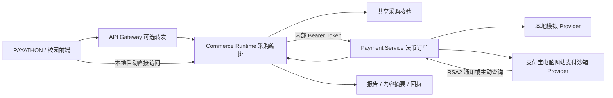

# 两场比赛共用的采购 MVP

校园分支已补充真实模型的原文抽取、人工确认、证据分级及导出，详见 [校园AI闭环](AGENT-EMERGENCE-MVP.md)。校园启动使用 `-Competition campus -UseLLM`，只运行Runtime，不启动支付服务；本轮不要求支付。下文的双服务支付联调说明适用于PAYATHON配置。

## 复用关系



现有 `payment-service/cmd/server` 可用 `FIAT_HTTP_ADDR` 开启 MySQL 法币监听器。原 Kitex USDC/USDT 转账仍使用原币种精度、钱包与链上状态；CNY 走新增 provider 边界，不复用链上单位或把支付宝交易号冒充 tx hash。

`commerce-runtime/internal/procurement` 是两场比赛共用的预算、规格、审批记录、来源与票据核验。`procurementmvp` 负责服务发现、报价、用户确认、payment-service 调用及交付。模型只能建议白名单中的服务，不掌握报价或支付权限；使用已有 `internal/llm` 客户端。未配置模型时显示规则规划，不伪造模型调用。

## Windows 一键运行

从仓库根目录执行：

```powershell
powershell -NoProfile -ExecutionPolicy Bypass -File .\scripts\start-procurement-mvp.ps1
```

打开 `http://127.0.0.1:8093/`，默认 PAYATHON。`/campus` 为校园入口，`/stablepay` 为原介绍页。服务在后台隐藏运行；脚本打印地址，不打开窗口。首次运行需要 Go、Node.js 及依赖下载。日志与订单在忽略目录 `.local-run/procurement-mvp`。

```powershell
# 校园入口使用相同服务端核验；没有共享服务时仍保留浏览器本地预审。
powershell -NoProfile -ExecutionPolicy Bypass -File .\scripts\start-procurement-mvp.ps1 -Competition campus

# 停止本脚本启动的进程，保留订单与报告。
powershell -NoProfile -ExecutionPolicy Bypass -File .\scripts\stop-procurement-mvp.ps1
```

启动前应先停止另一个 profile；8092 为法币支付内部接口，8093 为 Runtime 与静态站点。默认只监听 loopback。

前端单独开发可运行 `npm run dev:payathon`，Vite 将 `/api/mvp` 转发到 Runtime。对应 Runtime 的 `MVP_PUBLIC_ORIGIN` 需为 `http://127.0.0.1:5173`；不要同时把它设置成静态站点的 8093 来源。

## 支付宝配置

在运行启动脚本的 PowerShell 进程中设置 `payment-service/.env.fiat.example` 所列环境变量。脚本不自动读取 `.env`，私钥仅从本机文件读取，不提交源码。

```powershell
# 配置沙箱 APP_ID、SELLER_ID、公私钥文件路径、HTTPS 通知与返回地址后：
powershell -NoProfile -ExecutionPolicy Bypass -File .\scripts\start-procurement-mvp.ps1 -PaymentMode alipay_sandbox
```

本地模拟结算接口在 Alipay 模式下禁用。前端返回 URL 不改变支付状态；通知必须通过 RSA2、公钥、app_id、seller_id、订单金额校验；主动查询必须通过响应签名、商户订单及金额校验。正式生产 provider 尚未开放。

已有完整微服务环境可先执行 `payment-service/migrations/20261028_fiat_payment_snapshots.sql`，然后用 `FIAT_HTTP_ADDR`、`FIAT_INTERNAL_TOKEN` 开启原 payment-service 进程的法币监听。其使用现有 MySQL 连接。法币表采用事务锁保护的小型 JSON checkpoint，适用于当前 MVP，尚未做高并发数据库验收。

网关可设置 `PROCUREMENT_MVP_URL=http://commerce-runtime:8093` 和 `FIAT_PAYMENT_HTTP_URL=http://payment-service:8092`，分别转发 `/api/mvp/*` 和 `/api/payments/alipay/notify`。内部法币订单 API 不经公网网关暴露。浏览器会话与来源校验由 Runtime 处理；原网关的 readiness 仍需满足。

## 可复现验收

Web 与外部 Agent 使用相同 Runtime API。Agent 客户端可执行 `node scripts/procurement-agent.mjs help` 查看服务发现、计划、报价、明确确认、收银台与回执命令。显式的 `agentpay-prepare` / `agentpay-submit` 在Agent本机调用官方支付CLI；客户端不读取商家支付宝私钥，会话文件保存在忽略目录。支付确认必须绑定本次商户、服务和金额。

官方 PC 路线是在取得签名收银台 URL 后，按[官方指南](https://aipay.alipay.com/docs/agent-pay/skillpay.html)交给 `alipay-bot trigger-payment-signal`，再将其返回的短链交给 `alipay-bot submit-payment`。2026-10-28已安装官方CLI 0.4.8并核对命令参数，详见[Harness接入说明](AGENTPAY-HARNESS.md)。已实际执行两笔用户确认的沙箱订单联调：signal成功，submit返回 `SIGN_VERIFY_FAILED`；第二笔在钱包已bound后仍复现，官方查询为UNKNOWN，没有新报告交付。PC工具对当前沙箱的支持及权限要求仍需官方核实，见[实际记录](AGENTPAY-LIVE-2026-10-28.md)和[咨询草稿](AGENTPAY-SUPPORT-REQUEST.md)。普通网页沙箱付款与此工具链结果分别记录。

```powershell
cd payment-service
go test ./internal/fiat ./internal/application/service ./internal/adapter/rpc ./cmd/server
cd ../commerce-runtime
go test ./internal/procurement ./internal/procurementmvp ./cmd/procurement-mvp
cd ../stablepay-frontend
npm run build:payathon
cd ..
node scripts/test-procurement-mvp.mjs http://127.0.0.1:8093 .local-run/procurement-mvp/validation.json
```

最后一条跨进程验收拒绝非 `local` provider，检查明确确认、付款前禁止交付、请求幂等、会话隔离、服务费预算上限及交付重放。样例物资金额为 ¥536.00、预算 ¥500.00，并存在规格不符和票据待确认。测试记录属于工程验收，不是实际支付宝支付或真实校园用户效果。

订单与报告采用服务端快照保存，报价五分钟有效；用户确认后生成固定金额的支付订单。回执绑定 quote hash、approval ref、支付结果来源和报告内容摘要。重复确认或重复通知不产生新支付与第二次交付。

10月29日已按官方支付处理Skill修正真实会话UUID、意图摘要与钱包调用顺序，12项本地替身测试通过；服务器实际配置及公钥指纹与本机一致，官方沙箱控制台显示的应用公钥、AppID及商户PID也已独立比对一致。两笔失败联调记录保留，未创建第三笔订单。详见[协议审计](AGENTPAY-PROTOCOL-AUDIT-2026-10-29.md)。本地协议测试通过不等于官方支付验收通过。

## 分支同步

共享服务端、支付 provider、入口、配置与测试以独立提交同步到 `contest/alipay-agent-emergence-2026`。前端用 Vite mode 选择默认首页：普通构建仍为校园页，`build:payathon` 为 PAYATHON 页。两种入口均可显式访问，无需复制业务代码。
