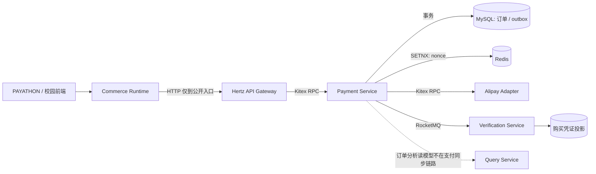

# 两场比赛共用的采购 MVP

## 服务边界



公网业务入口由 Hertz Gateway 统一承接，Payment Service 不再开放 Fiat HTTP sidecar。Gateway 经 Kitex 调用 Payment Service；Payment Service 持有 MySQL 订单和事务 outbox、Redis nonce，并通过 Kitex 调用独立的 Alipay Adapter。PAID/CLOSED 与 outbox 在同一 MySQL 事务提交，后台 dispatcher 发布 `payment_events`；Verification Service 复用已有 RocketMQ 消费者写入购买凭证。Commerce Runtime 查询 CNY 权益时复用 Verification Service。Query Service 面向链上分析报表，不负责同步确认 CNY 付款。

链上 USDC/USDT 仍使用原有支付验证、Blockchain Adapter、钱包与精度。CNY 金额以人民币分存储，支付宝交易号只作为支付提供方凭证，不冒充链上 tx hash。

PAYATHON 的 procurement MVP 也只访问 Hertz Gateway。浏览器会话/报价/报告仍由 Commerce Runtime 管理；payment-service 是支付订单的唯一状态源。Agent 的建议不改变报价和用户确认授权。

## Windows 本地运行

首次准备支付宝沙箱配置时，仓库 `.env` 需包含沙箱 `ALIPAY_APP_ID`、`ALIPAY_SELLER_ID`，密钥文件放在 `.local-run/secrets/alipay/`。准备脚本会规范化密钥并生成权限受限的本地 Compose 环境文件，不打印密钥、标识符或 token：

```powershell
node scripts/prepare-alipay-sandbox.mjs https://your-public-origin
```

回调域名必须能将 `/api/payments/alipay/notify` 转发到当前 Hertz Gateway。脚本只写本机配置，不会部署或改动公网路由。

启动完整本地依赖和 Payathon UI：

```powershell
powershell -NoProfile -ExecutionPolicy Bypass -File .\scripts\start-procurement-mvp.ps1 -PaymentMode alipay_sandbox -AlipayPublicOrigin https://your-public-origin
```

需要 Docker Desktop、Go 和 Node.js。入口为 `http://127.0.0.1:8093/payathon`。公开 API Gateway 映射到本机 `28080`；Payment Service Kitex 为 `8888`，Alipay Adapter Kitex 为 `8086`，MySQL/Redis/RocketMQ 分别使用本地 `3307/6379/9876`。本地出站付款后可由 Payment Service 向支付宝发起已验签查单，状态仍以 Payment Service 的订单为准。对外可达的 callback host 才能验证实时 notify 回调。

`-PaymentMode local` 可用于离线演示。模拟结算经由 Gateway/Kitex，且 Payment Service 在 `alipay_sandbox` 下会拒绝模拟结算。

```powershell
# 校园入口使用相同后端
powershell -NoProfile -ExecutionPolicy Bypass -File .\scripts\start-procurement-mvp.ps1 -Competition campus -PaymentMode local

# 停止网页 Runtime，保留订单和报告；Compose 依赖可单独管理
powershell -NoProfile -ExecutionPolicy Bypass -File .\scripts\stop-procurement-mvp.ps1
```

日志与 Runtime 的采购/报告文件保存在忽略目录 `.local-run/procurement-mvp`；支付订单、幂等键与 outbox 在 MySQL，nonce 在 Redis。沙箱 Compose 环境文件、支付宝私钥和本机支付 token 保存在 `.local-run/procurement-deploy/private`，不可提交。

## 可复现验收与边界

```powershell
cd alipay-adapter
go test ./...
cd ../payment-service
go test ./...
cd ../api-gateway
go test ./...
cd ../commerce-runtime
go test ./...
```

验收覆盖 Adapter RSA2 签名/查单响应验签、金额精度、订单幂等和 nonce、Gateway 路由、Runtime 报价/确认及重复交付。Redis/MySQL/RocketMQ 投影的跨容器联调需要 Docker Engine 可用；真实支付宝交易仍需沙箱买家完成页面确认。

官方 PC Agent Pay 路线是在取得签名收银台 URL 后，按[官方指南](https://aipay.alipay.com/docs/agent-pay/skillpay.html)交给 `alipay-bot trigger-payment-signal`，再将短链交给 `alipay-bot submit-payment`。2026-10-28 的两笔测试均为 signal 成功、submit 返回 `SIGN_VERIFY_FAILED`，没有订单交付；该工具链结果与普通网页沙箱付款分别记录，详见[Harness 接入说明](AGENTPAY-HARNESS.md)、[实际记录](AGENTPAY-LIVE-2026-10-28.md)和[官方咨询草稿](AGENTPAY-SUPPORT-REQUEST.md)。

共享服务端、支付 provider、入口、配置与测试应在 `contest/payathon-2026` 和 `contest/alipay-agent-emergence-2026` 同步。前端 Vite mode 选择默认首页：普通构建仍为校园页，`build:payathon` 为 PAYATHON 页。
